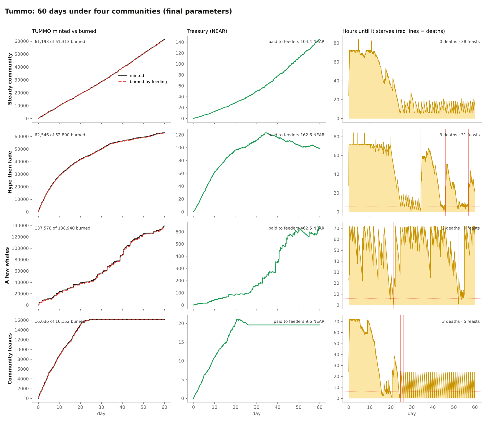

# Tummo

A memecoin that is alive. Built at NEAR HACKATHON, Track 11: Memecoins With Mechanics.

Tummo is one shared pet. Holders buy $TUMMO and feed it. Fed TUMMO is burned and buys the pet time. While it lives, its treasury pays the people who fed it. If nobody feeds it in time, it starves, goes to the graveyard, and a new egg hatches.

## Rules

| | |
|---|---|
| Buy | TUMMO is minted on a linear curve over every TUMMO ever minted. 100% of the NEAR goes to the treasury. Burning never lowers the price. |
| Feed | Burns TUMMO. 1 TUMMO buys a newborn 10 minutes. Level = √(eaten ÷ 250), and each level makes TUMMO buy less time. It can't be fed more than 3 days ahead. |
| Get paid | While alive, 3% of the treasury per day drips to feeders, split by love. Love = TUMMO fed this life. |
| Rescue | Feeding in its last 6 hours counts double love. |
| Feast | When 10 accounts each feed it 25+ TUMMO within one day of its life, it gets +12h. Once a day. An account only counts if it bought TUMMO at least an hour earlier. |
| Sell | Any holder can sell TUMMO back. Each TUMMO pays treasury ÷ supply, minus 10% that stays in the treasury. The TUMMO is burned. Paying a share, never a fixed price, means the treasury can never run dry. |
| Death | Dripping stops at the moment of death. Earned NEAR stays claimable. Love resets, the life is recorded in the graveyard, and a new egg hatches with what's left of the treasury. An ignored egg dies in 24h. |

## Track fit

- **Supply that reacts to the community.** Every feed burns TUMMO, and a bigger pet burns faster.
- **Treasury with rules.** It drips only while the pet is alive, only to feeders, at a fixed 3% a day. Sellers can only take their share minus a 10% fee. No admin.
- **Rituals and challenges.** Daily feeding, rescues in the last 6 hours, 10-feeder feasts, and a graveyard that keeps every life.
- **NEP-141.** TUMMO is a standard token.

## Nobody can change the rules

Every parameter is a constant in `contract/src/lib.rs`, and `get_config()` returns all of them. There is no owner and no method that changes a rule.

That alone isn't enough: whoever deploys a contract keeps the account's access keys and could deploy new code. `scripts/deploy-and-lock.sh` deploys, runs a smoke test, then deletes every access key on the contract account. After that, nobody can redeploy it, change a rule or move the treasury. The app reads the account's key list from RPC and shows **No admin keys** only when the list is empty.

## Sybil resistance, and its limits

The only reward that depends on how many people take part is the feast. Love and the drip scale with TUMMO burned, so splitting it across accounts earns nothing extra.

To count toward a feast, an account must feed at least **25 TUMMO** in one go and must have **bought TUMMO at least an hour earlier**. Ten fake accounts therefore need ten buys, an hour of waiting and at least 250 TUMMO burned. That costs NEAR and storage, and the burned TUMMO still feeds the real pet.

What it doesn't stop:
- Anyone patient enough to prepare 10 funded accounts more than an hour ahead can trigger a feast alone. The prize is 12 hours of life, not money.
- TUMMO sent to an account by transfer doesn't count as buying, so a whale can't hand TUMMO to sock puppets to skip the wait. They can still buy with each one.
- There is no proof of personhood. Doing better would take something like a NEAR social graph or an account-age oracle, which is out of scope for now.

## 60-day simulation

Before choosing parameters, tummo was simulated for 60 days under four communities: steady, hype then fade, a few whales, and a community that leaves. See `sim/`.



What the parameters were chosen for:
- **A steady community keeps it alive** (0 deaths), and spends about 4% of the time in the rescue zone, so rescues happen without being constant.
- **Fading hype and whale-only play make it fragile** (2 to 3 deaths in 60 days).
- **Whales can't fake a community.** With 3 whales and 6 regulars there were 0 feasts.
- **If everyone leaves, it dies and the treasury freezes.** Nothing drips without feeders, so the treasury waits for a comeback. Unfed eggs hatch and go cold every 24h.
- A faster appetite (√(eaten ÷ 100)) left a steady community starving 18% of the time. 300 seconds per TUMMO killed it even in the steady case.

Averages over 5 seeds:

| Parameters | Scenario | Deaths | Feasts | TUMMO burned | Paid to feeders (NEAR) |
|---|---|---|---|---|---|
| A  600s/TUMMO, 3%/day, level 100 | Steady community | 0.0 | 48.8 | 81,594 | 149.8 |
| A  600s/TUMMO, 3%/day, level 100 | Hype then fade | 4.0 | 31.8 | 66,568 | 175.5 |
| A  600s/TUMMO, 3%/day, level 100 | A few whales | 3.2 | 0.0 | 138,290 | 467.2 |
| A  600s/TUMMO, 3%/day, level 100 | Community leaves | 3.6 | 6.4 | 16,085 | 9.5 |
| B  300s/TUMMO, 3%/day, level 100 | Steady community | 3.0 | 46.4 | 88,838 | 201.0 |
| B  300s/TUMMO, 3%/day, level 100 | Hype then fade | 8.0 | 38.8 | 70,643 | 188.9 |
| B  300s/TUMMO, 3%/day, level 100 | A few whales | 7.0 | 0.0 | 145,140 | 526.3 |
| B  300s/TUMMO, 3%/day, level 100 | Community leaves | 5.8 | 10.0 | 19,050 | 12.0 |
| C  600s/TUMMO, 2%/day, level 400 | Steady community | 0.0 | 29.0 | 57,579 | 71.2 |
| C  600s/TUMMO, 2%/day, level 400 | Hype then fade | 1.6 | 33.4 | 63,551 | 129.2 |
| C  600s/TUMMO, 2%/day, level 400 | A few whales | 1.6 | 0.0 | 137,339 | 354.4 |
| C  600s/TUMMO, 2%/day, level 400 | Community leaves | 2.4 | 3.4 | 14,545 | 6.1 |
| D  900s/TUMMO, 2%/day, level 400 | Steady community | 0.0 | 20.8 | 53,599 | 66.9 |
| D  900s/TUMMO, 2%/day, level 400 | Hype then fade | 1.0 | 29.8 | 62,253 | 127.8 |
| D  900s/TUMMO, 2%/day, level 400 | A few whales | 1.2 | 0.0 | 131,701 | 337.3 |
| D  900s/TUMMO, 2%/day, level 400 | Community leaves | 2.0 | 2.2 | 14,060 | 6.0 |
| Final  600s/TUMMO, 3%/day, level 250 | Steady community | 0.0 | 38.2 | 60,711 | 101.9 |
| Final  600s/TUMMO, 3%/day, level 250 | Hype then fade | 2.4 | 33.4 | 64,689 | 168.9 |
| Final  600s/TUMMO, 3%/day, level 250 | A few whales | 2.0 | 0.0 | 139,182 | 475.7 |
| Final  600s/TUMMO, 3%/day, level 250 | Community leaves | 2.8 | 4.4 | 15,125 | 8.9 |

## Full history

Every buy (mint), feed (burn), rescue, feast and death is emitted as a NEP-297 event (`standard: "tummo"`), so the complete log lives on-chain and in any explorer. The contract also keeps the last 100 entries for the app, and the Log tab links to the account on NearBlocks for everything older.

## meme.cooking

meme.cooking is NEAR's fair-launch memecoin launchpad: tokens are distributed by auction, with no presale or team allocation, and graduate to Ref Finance. tummo can't be a meme.cooking token, because meme.cooking deploys its own token contract and tummo's mechanic has to live inside the token contract itself. The path that fits is the one meme.cooking tokens take after launch: a TUMMO/NEAR pool on Ref Finance for secondary trading, while minting stays on tummo's curve and every mint still feeds the treasury.

## NEAR

- NEP-141 token with NEP-297 events (`buy`, `feed`, `rescue`, `feast`, `death`)
- On-chain activity log and graveyard, read straight from RPC. No indexer.
- Wallet Selector with Meteor, MyNearWallet and HERE
- Sign in with X: Privy creates a NEAR account for the player, no wallet app needed

## Contract

```bash
cd contract
cargo test          # 15 tests
cargo near build non-reproducible-wasm
```

GitHub Actions builds `tummo.wasm` on every push.

```bash
./scripts/deploy-and-lock.sh tummo.yourname.testnet testnet tummo.wasm
```

Methods: `buy({count})` payable, `feed({count})`, `claim()`, `bury()`, `sell({count})`, views `sell_quote({count})`, `get_config()`, `get_pet()`, `get_feeder({account_id})`, `quote({count})`, `get_graves()`, `get_activity()`, plus NEP-141.

## Web

```bash
cd web
cp .env.example .env    # set VITE_CONTRACT_ID to your testnet contract
npm i --legacy-peer-deps && npm run dev
```

The pet is an original SVG drawing. Line boil (feTurbulence + feDisplacementMap, re-seeded about 9 times a second) makes the outline wobble like hand-drawn animation.

The four intro slides use drawn scenes in the same ink style as the pet.

## Sign in with X

Signing in with X creates an embedded NEAR wallet through [Privy](https://privy.io), based on [near-examples/hello-privy](https://github.com/near-examples/hello-privy). Transactions are signed by Privy and sent with near-api-js, so the player never leaves the page.

Setup:

1. Create a Privy app. Under login methods, turn on Twitter. Under embedded wallets, turn on NEAR.
2. Set `VITE_PRIVY_APP_ID` and `VITE_PRIVY_APP_CLIENT_ID` in `web/.env`. Leave them empty and the X button is hidden.

Limits:

- The account is an implicit account (64 hex characters). It exists on-chain only after it receives NEAR, so a new player has to fund it first. The app shows the address, a copy button and a testnet faucet link when the balance is zero.
- One X account gets one wallet, but that is enforced by Privy, not by the contract. The sybil limits above still apply on-chain.
